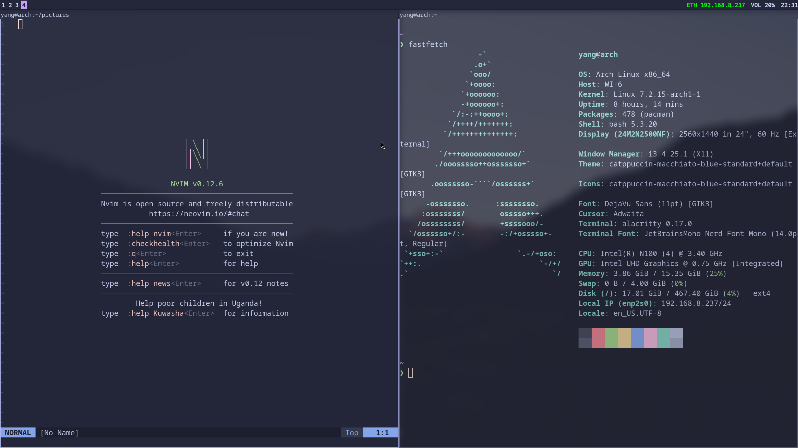

# Dotfiles

My personal dotfiles for Arch Linux, featuring a minimal i3 desktop environment with Catppuccin Macchiato colors.

> Simplicity is the ultimate sophistication.

## Preview



## Environment

| Component | Software |
|---|---|
| Operating System | Arch Linux |
| Window Manager | i3 |
| Terminal | Alacritty |
| Editor | Neovim |
| Shell | Bash |
| Prompt | Starship |
| Compositor | Picom |
| Application Launcher | Rofi |
| GTK Theme | Catppuccin Macchiato |
| Icons | Catppuccin Macchiato |
| Terminal Font | JetBrainsMono Nerd Font |

## Configuration

```text
dotfiles/
├── alacritty/
├── bash/
├── foot/
├── gtk-3.0/
├── i3/
├── nvim/
├── picom/
├── redshift/
├── rofi/
├── starship/
├── sway/
├── tmux/
├── wallpaper/
├── wofi/
├── user-dirs.dirs
└── README.md
```

## Features

- Minimal and keyboard-driven desktop workflow
- Catppuccin-inspired visual consistency
- Lightweight i3 window management
- Neovim configuration with plugin support
- Custom terminal and shell configuration
- Compositor and application launcher customization
- Configuration files for both X11 and Wayland environments

## Installation

Clone the repository:

```bash
git clone https://github.com/liftctrl/dotfiles.git
cd dotfiles
```

Back up your existing configurations before copying the files you need into `~/.config/`.

These dotfiles are tailored to my personal setup and may require adjustments for other systems.

## Credits

- [Arch Linux](https://archlinux.org/)
- [i3](https://i3wm.org/)
- [Neovim](https://neovim.io/)
- [Catppuccin](https://catppuccin.com/)
- [Alacritty](https://alacritty.org/)

